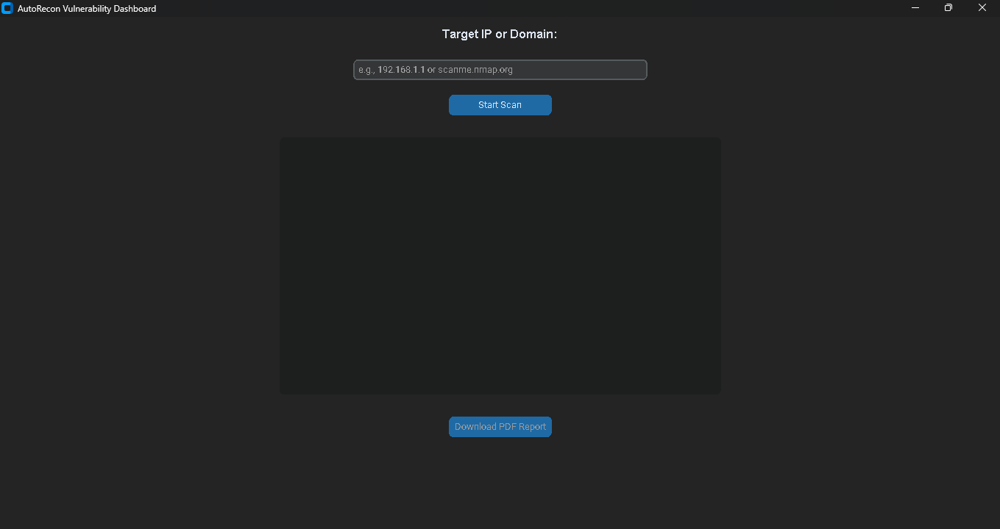

# AutoRecon Vulnerability Dashboard 🛡️

A Python-based GUI application designed for Vulnerability Assessment and Network Reconnaissance. This tool automates basic security checks by integrating `nmap` and `requests` into a clean, thread-safe dashboard. 

## Features
- **Automated Port Scanning:** Utilizes `python-nmap` to discover open ports and running services.
- **Security Header Analysis:** Checks target web servers for missing critical security headers (e.g., CSP, HSTS, X-Frame-Options).
- **PDF Report Generation:** Instantly exports scan results into a formatted PDF document for documentation and auditing.
- **Modern UI:** Built with `customtkinter` featuring a responsive, dark-mode GUI.

## Screenshot

## Installation & Usage
1. Install requirements: `pip install -r requirements.txt`
2. Run the tool: `python recon_tool.py`
3. Enter target IP/Domain and click "Start Scan".

## Academic Context
Developed as an academic project for the **Vulnerability Assessment & Reverse Engineering (CYS400)** course at Mehran University of Engineering and Technology. Designed to demonstrate practical network enumeration and automated reporting skills relevant to SOC Analyst workflows.